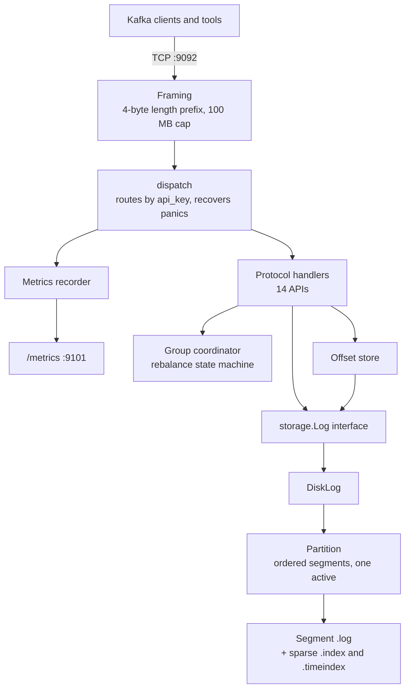
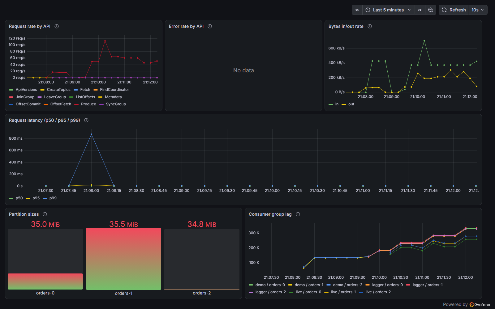

# kafka-go

[](https://github.com/AfzalRaja001/kafka-go/actions/workflows/ci.yml)

A message broker that speaks the real Apache Kafka wire protocol, built from scratch in Go. The official
Kafka command-line tools and client libraries connect to it, within the limits listed below.

Rather than inventing a custom API, it implements the actual binary protocol (framing, record batches,
consumer group rebalancing, offset storage) on top of a durable, segmented on-disk log, so existing Kafka
clients such as `kafka-console-producer.sh` and `franz-go` can talk to it unchanged.

It is a **single-node** broker: one process, no replication. Read [Known limitations](#known-limitations)
before pointing anything important at it.

## What works

- **Produce and Fetch** over the Kafka record batch format (v2), with real long-polling on Fetch.
- **Consumer groups**: JoinGroup, SyncGroup, Heartbeat and LeaveGroup with leader-computed assignments,
  rebalancing, and a background reaper that evicts members that go silent.
- **Committed offsets**, stored in an internal `__consumer_offsets` topic, replayed on startup, and
  compacted in the background.
- **Topic management**: CreateTopics and DeleteTopics provision and remove storage for real, and the topic
  list is saved to disk, so topics survive a restart.
- **Durable storage**: append-only segment files with sparse offset and time indexes, torn-write recovery
  after a crash, and a configurable fsync policy (every 1000 records or 5 seconds, whichever comes first).
- **Retention**: segments older than 7 days are deleted in the background.
- **Observability**: a Prometheus `/metrics` endpoint and a pre-provisioned Grafana dashboard.
- **Packaging**: a multi-stage Docker image and a Compose file that starts the broker, Prometheus and
  Grafana together.

About 5,400 lines of Go and 6,700 lines of tests (260+ test functions). CI runs build, vet and the full test
suite under the race detector on every push.

### Supported APIs

Each API supports exactly one version, chosen on purpose: low versions keep clients away from the newer
"flexible" encoding, which is a different wire format this broker does not implement.

| API | Key | Version |
|---|---|---|
| Produce | 0 | 3 |
| Fetch | 1 | 0 |
| ListOffsets | 2 | 1 |
| Metadata | 3 | 1 |
| OffsetCommit | 8 | 0 |
| OffsetFetch | 9 | 2 |
| FindCoordinator | 10 | 0 |
| JoinGroup | 11 | 0 |
| Heartbeat | 12 | 0 |
| LeaveGroup | 13 | 0 |
| SyncGroup | 14 | 0 |
| ApiVersions | 18 | 0 |
| CreateTopics | 19 | 0 |
| DeleteTopics | 20 | 0 |

## Quickstart

You need Docker (with Compose v2) to run the whole stack, plus an extracted
[Apache Kafka 3.9 download](https://archive.apache.org/dist/kafka/3.9.1/) and Java 17 or newer to use the
official command-line tools.

**1. Start the broker, Prometheus and Grafana**

```bash
git clone https://github.com/AfzalRaja001/kafka-go.git
cd kafka-go
docker compose -f deploy/docker-compose.yml up -d --build
```

The first start is slow: Docker pulls its base images, builds the broker, and Grafana initialises its
database, which took about 8 minutes in total on the test laptop. Later starts after `docker compose stop`
are quick. The broker listens on `localhost:9092`, and its raw metrics are on `localhost:9102` (port 9101
when you run the broker natively, which is the port the Prometheus config also checks for a native broker).
Prefer to skip Docker? `go run ./cmd/broker` starts just the broker (Go 1.26 or newer).

**2. Create a topic, produce and consume with the official Kafka tools**

Run these from inside the extracted Kafka directory:

```bash
bin/kafka-topics.sh --bootstrap-server localhost:9092 \
  --create --topic orders --partitions 3 --replication-factor 1

printf 'hello\nworld\n' | bin/kafka-console-producer.sh \
  --bootstrap-server localhost:9092 --topic orders \
  --producer-property enable.idempotence=false

bin/kafka-console-consumer.sh --bootstrap-server localhost:9092 \
  --topic orders --from-beginning --max-messages 2
```

Two details matter:

- `--replication-factor 1` is required. Without it the tool asks the broker to pick defaults, which needs a
  newer CreateTopics version than this broker supports.
- `enable.idempotence=false` is required for the producer. Kafka 3.x clients turn idempotence on by default,
  which calls `InitProducerId`, an API this broker does not implement.

**3. Look at the dashboard**

Open <http://localhost:3000>. The "kafka-go broker" dashboard is already provisioned, with no login and no
manual setup. Prometheus is at <http://localhost:9090>. To stop everything: `docker compose -f
deploy/docker-compose.yml down` (add `-v` to also delete the broker's data volume).

### Compatibility with the official tools

Tested against the Apache Kafka 3.9.1 command-line tools:

| Tool | Result |
|---|---|
| `kafka-topics.sh --create`, `--list`, `--delete` | Works, including `TopicExistsException` on a duplicate |
| `kafka-console-producer.sh` | Works with `enable.idempotence=false` |
| `kafka-console-consumer.sh`, with and without `--group` | Works; a repeated group run resumes at the committed offset |
| `kafka-producer-perf-test.sh` | Works with `enable.idempotence=false` |
| `kafka-topics.sh --describe` | Fails: needs `DescribeConfigs`, not implemented |
| `kafka-consumer-groups.sh --list` and `--describe` | Fail: need `ListGroups` and `DescribeGroups`, not implemented |
| `kafka-get-offsets.sh` | Fails: needs Metadata v4 or newer, the broker speaks v1 |

The [franz-go](https://github.com/twmb/franz-go) client library works as well; it is also what the benchmark
tool and the test harness use.

## Architecture



The code is split along one deliberately narrow seam, the `storage.Log` interface in
[internal/storage/log.go](internal/storage/log.go):

- **`internal/protocol`** decodes requests and encodes responses. It knows the Kafka wire format and nothing
  about files.
- **`internal/broker`** owns the TCP listener, message framing and the `dispatch` function that routes each
  request by its `api_key`.
- **`internal/storage`** implements the log: segments, indexes, partitions, crash recovery, retention. It
  knows nothing about Kafka's protocol, which is what lets it be tested on its own and swapped for an
  in-memory fake in handler tests.
- **`internal/group`** is the consumer group coordinator, with zero dependencies on the rest of the project.
- **`internal/offsets`** persists committed offsets into a real internal topic.
- **`internal/metrics`** is the Prometheus recorder.

The most important design decision: **record batches are stored verbatim.** The broker parses only the fixed
61-byte batch header, to read the record count and to rewrite the base offset and recompute the CRC. It never
decodes or re-encodes the records inside, so what a producer sent is exactly what a consumer receives, and a
batch costs one disk write.

## Storage

Each topic partition is a directory of segments. A segment is an append-only `.log` file named by its base
offset, with a sparse `.index` (offset to byte position) and a `.timeindex` (timestamp to offset).

- **Rolling**: a new segment starts when the active one reaches 16 MB. Only the newest segment is writable.
- **Recovery**: on startup each segment is scanned forward and truncated at the first incomplete write, the
  state a crash mid-append leaves behind.
- **Durability**: the active segment is fsynced every 1000 appended records or every 5 seconds, and a segment
  is always fsynced when it rolls. In a crash test (4 producers, `kill -9` mid-write), 0 of 45,160
  acknowledged records were lost.
- **Topic list**: which topics exist, and how many partitions each has, is saved in `data/topics.json`. The
  partition directories next to it hold the records but cannot say which of them are topics. Every change is
  written to a temporary file, fsynced, and renamed over the real one, so a crash leaves either the old list
  or the new one, never a mix. A file that is corrupt or has an unknown version stops the broker at startup
  instead of letting it start empty. In a test that hard-killed the broker three times in the middle of
  bursts of CreateTopics, all 1,090 acknowledged topics were still there afterwards. Leader and replica IDs
  are not stored; they come from `KAFKA_NODE_ID` each time the broker starts.
- **Retention**: a background job deletes whole segments older than 7 days, oldest first, never the active
  one. A fetch below the earliest remaining offset returns `OFFSET_OUT_OF_RANGE`.
- **Compaction**: the internal `__consumer_offsets` topic is compacted to one record per key so it does not
  grow forever. This is deliberately not general per-topic log compaction.

## Observability

The broker serves Prometheus metrics at `/metrics` on port 9101 (published on host port 9102 by the Compose
stack):

| Metric | Meaning |
|---|---|
| `kafkago_requests_total` | Requests by API and outcome |
| `kafkago_request_duration_seconds` | Latency histogram by API |
| `kafkago_request_bytes_total` | Bytes in and out |
| `kafkago_partition_bytes` | On-disk size per topic partition |
| `kafkago_consumer_group_lag` | How far each group's committed offset trails the log end |

The Compose stack provisions Prometheus and a six-panel Grafana dashboard from files in
[deploy/](deploy/), so there is nothing to import by hand.



The dashboard above was captured while the official `kafka-producer-perf-test.sh` and three consumer groups
(two of them deliberately lagging) ran against the Docker broker. The error-rate panel reads "No data"
because no request failed.

## Benchmarks

Measured on a laptop: Intel Core i7-8550U (4 cores, 8 threads), 15.8 GB RAM, SATA SSD, Windows 11. The
benchmark client and the broker ran on the same machine, with the default configuration (fsync every 1000
records or 5 seconds). Each row is a single 10-second run, not an average, so read the numbers as an order of
magnitude and not a guarantee.

| Workload | Records/sec | MB/sec | Latency |
|---|---|---|---|
| `cmd/benchmark` produce, 4 producers, 1 partition, 256 B records | 11,216 | 2.74 | p95 0.91 ms, p99 3.49 ms |
| `cmd/benchmark` produce, 4 producers, 3 partitions, 100 B records | 11,611 | 1.11 | p95 1.01 ms, p99 4.39 ms |
| `cmd/benchmark` produce, 4 producers, 3 partitions, 1 KiB records | 10,390 | 10.15 | p95 0.71 ms, p99 2.31 ms |
| `cmd/benchmark` fetch, 4 consumers each reading a full 1-partition topic | 36,672 | 8.95 | p95 31.3 ms, p99 36.5 ms |
| Official `kafka-producer-perf-test.sh`, batching, 100 B records, 1 partition, broker run natively | 50,556 | 4.82 | avg 6.1 ms, p99 22 ms |
| Same official tool, 200,000 records, broker in the Docker container | 98,863 | 9.43 | avg 16.3 ms, p99 51 ms |

How to read these:

- The `cmd/benchmark` producers send **one record per request and wait for each acknowledgement**, so the
  produce rows measure round-trip latency across four producers, not the broker's ceiling. The official tool
  batches records, which is why it is about 4.5 times faster on the same broker.
- The two official-tool rows are different runs (50,000 vs 200,000 records) of the same tool, and the Docker
  broker is a Linux container on the same laptop, so the gap between them is not a clean native-versus-Docker
  comparison.
- Multi-partition fetch is not reported. With several partitions the fetch phase did not finish within the
  benchmark's 30-second cap, because of the fetch latency issue listed under
  [Known limitations](#known-limitations). Reading the same 3-partition topic took 7.2 s with the default 5 s
  fetch wait and 2.1 s with a 100 ms wait.

Reproduce the first row against a running broker with:

```bash
go run ./cmd/benchmark -topic bench-a -partitions 1 -record-size 256 -duration 10s -producers 4 -consumers 4
```

The other rows change `-partitions` and `-record-size`; see `-help` for every flag.

## Configuration

The advertised address is configured with environment variables, which a real deployment needs: the broker
tells clients where to reconnect, so on a server it must advertise an address clients can reach, not
`localhost`.

| Variable | Default | Meaning |
|---|---|---|
| `KAFKA_ADVERTISED_HOST` | `localhost` | Host returned to clients in Metadata and FindCoordinator |
| `KAFKA_ADVERTISED_PORT` | `9092` | Port returned to clients |
| `KAFKA_NODE_ID` | `1` | This broker's node ID |
| `KAFKA_MAX_PARTITIONS` | `0` (no limit) | Most partitions allowed across all topics together; `CreateTopics` beyond it fails with `INVALID_PARTITIONS` |
| `KAFKA_RETENTION_MAX_BYTES` | `0` (no limit) | Size cap per partition in bytes; the oldest segments are deleted when a partition is over it |

The last two exist for a broker that strangers can reach, since there is no authentication: they bound how much
disk and how many file handles a client can use. A partition can overshoot its size cap between retention
sweeps (every 5 minutes), and the segment being written is never deleted.

A value that is set but invalid stops the broker at startup instead of silently falling back to the default.
Everything else (listen ports, data directory, segment size, retention age, fsync policy) is a constant in
[cmd/broker/main.go](cmd/broker/main.go); there is no config file yet.

## Known limitations

This is an honest list of what does not work yet. Items marked with a bug number are tracked in
[docs/plan.md](docs/plan.md) under "Found by the 2026-10-13 evaluation".

- **Single node, no replication.** One broker, one copy of the data.
- **No authentication or encryption.** There is no SASL and no TLS, so do not expose the broker to untrusted
  clients.
- **Record batches are only checked at the header** (bug 8): a corrupted payload is accepted, and a request
  carrying several batches is not handled correctly.
- **Fetch has two rough edges** (bugs 9 to 11): a record larger than the consumer's per-partition fetch size
  is never delivered, fetching past the end of the log waits and then reports success, and one idle partition
  delays data on others by up to the full fetch wait.
- **No idempotent or transactional producers**, so `InitProducerId` is missing, and the `acks` setting is read
  but ignored (`acks=0` still gets a response).
- **Some admin APIs are missing**: `DescribeConfigs`, `ListGroups`, `DescribeGroups`, and Metadata above v1.

## What I would do differently

- **Produce is serialized by one broker-wide lock.** It was the cheapest way to make "read the log end,
  patch the batch, append" atomic without widening the `Log` interface. It caps produce throughput, and a
  per-partition lock is the obvious replacement.
- **One version per API** keeps the codec small and clients away from flexible encoding, but it also locks
  out clients that have dropped old versions. Real version negotiation is the right long-term shape.
- **`Log.Compact` renumbers offsets from zero.** That is only safe for a topic nobody reads by offset, which
  is true of `__consumer_offsets` and nothing else. General per-topic compaction needs per-record keys
  inside batches and a storage format that can represent offset gaps, which breaks the store-batches-verbatim
  rule, so it was left out on purpose.
- **The topic list is one JSON file, rewritten whole on every CreateTopics or DeleteTopics.** That is simple
  and crash-safe (write, fsync, atomic rename), and fine for a handful of topics. At thousands of topics each
  change rewrites everything while holding the registry lock, and an append-only log of changes would scale
  better. Replication will also need real cluster metadata, which is a different problem from this file.

## Deploying it yourself

[docs/deployment.md](docs/deployment.md) is a step-by-step runbook for putting the broker on a free Oracle Cloud
VM with a public address: account and VM setup, firewall, the two scripts in [scripts/](scripts/), and how to
check it from outside. The production Compose file ([deploy/prod/](deploy/prod/)) publishes only the Kafka port;
metrics, Prometheus and Grafana stay on the VM's loopback and are reached through an SSH tunnel.

## Future work

Deliberately out of scope for now: transactions and exactly-once semantics, tiered storage, general per-topic
compaction, arbitrary-timestamp `ListOffsets` lookups, newer API versions, and SASL/TLS. Replication, with
`hashicorp/raft` for cluster metadata and follower fetch for the data path, is the planned next major phase
once the single-node broker is deployed and tagged.

## Project layout

```
cmd/broker        the broker binary, background jobs, configuration
cmd/benchmark     produce and fetch throughput benchmark (franz-go)
internal/protocol Kafka wire format: codecs, request handlers, record batches
internal/broker   TCP listener, framing, dispatch
internal/storage  segments, indexes, partitions, DiskLog, retention
internal/group    consumer group coordinator
internal/offsets  committed offsets stored in __consumer_offsets
internal/metrics  Prometheus recorder
deploy/           Dockerfile, local Compose stack, production Compose stack (deploy/prod), Prometheus and Grafana config
scripts/          VM setup and redeploy scripts
docs/             build plan, decision log, issue log, deployment runbook, working conventions
```

## Development

```bash
go build ./...
go vet ./...
go test -race -count=1 ./...
```

`-race` needs a C toolchain (cgo). The reasoning behind the major choices is in
[docs/decisions.md](docs/decisions.md), bugs found and fixed along the way are in
[docs/issues.md](docs/issues.md), and the full status and remaining work are in
[docs/plan.md](docs/plan.md).
